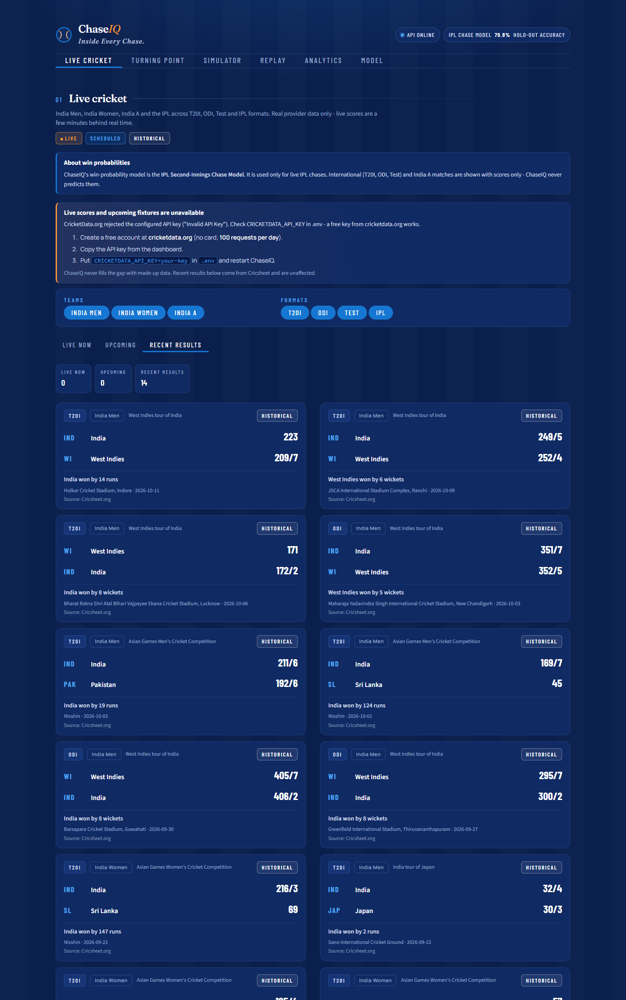
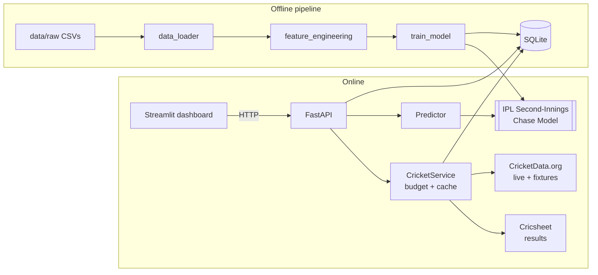

# ChaseIQ — *Inside Every Chase.*

ChaseIQ is an IPL run-chase analytics product: ball-by-ball **win probabilities**, a ball-by-ball chase **Simulator**,
and a **Live Cricket** page for India Men, India Women, India A and the IPL across T20I, ODI, Test and IPL formats.

> **The model is the *IPL Second-Innings Chase Model*.** It is trained only on IPL (2008–2025) second innings
> and is **never** applied to ODI, T20I or Test cricket, or to first innings. The API refuses such requests and
> the dashboard shows scores — never a probability — for international and India A matches.
> On 209 IPL matches from 2023–25 that it never saw in training: **79.8 % accuracy, 0.878 ROC-AUC.**



## Design

An Indian-jersey theme: navy (`#0B1F4D`) ground, jersey blue (`#1677D2`) for charts, buttons and the active
navigation, white for text and surfaces, and saffron (`#FF9933`) used sparingly for hypotheticals and a
few key figures. Colour meaning is fixed everywhere: **blue = the chasing side, white = the defending side,
saffron = hypothetical / key figure**. There is no green or red anywhere in the interface (Streamlit's own
success/warning/error colours are re-mapped in `.streamlit/config.toml`); only the franchise crests keep their
team colours.

## What every number is — Live, Historical or Hypothetical

| Tag | Meaning | Where |
|---|---|---|
| **LIVE** | A real match in progress, from a data provider | Live Cricket |
| **SCHEDULED** | A real upcoming fixture, from a data provider | Live Cricket |
| **HISTORICAL** | A real completed match (results, replay) | Live Cricket, Replay |
| **HYPOTHETICAL** | A what-if you created; not what happened | Simulator |

## Features

| Section | What it does |
|---|---|
| **Live Cricket** | Live scores, upcoming fixtures and recent results for India Men / Women / A and the IPL, filterable by team group and format. Live IPL chases also get a live win probability. |
| **Simulator** | Bowl a hypothetical IPL chase ball by ball, with a factor-by-factor explanation, next-over scenarios and a pressure map. |
| **Replay** | Animated ball-by-ball win-probability replay of any IPL chase since 2008. |
| **Analytics** | Seasons, Elo-rated teams, grounds, head-to-head, greatest escapes and biggest collapses (all SQL). |
| **Model** | Candidate comparison, calibration, accuracy by stage and honest limitations. |

## Live cricket data: sources, limits and what is *not* covered

ChaseIQ never invents a score or fixture. Each source reports its own state, and the page says plainly when
something is unavailable. Sources were checked on 2026-10-25.

| Source | Provides | Cost / limits | Verified |
|---|---|---|---|
| **[CricketData.org](https://cricketdata.org)** (CricAPI) | Live scores, upcoming fixtures | Lifetime-free plan, **100 requests/day**, data "a few minutes behind real time" (official pricing page). Needs a free key. | Limits ✔. **Women's / India A coverage could not be verified without a valid key.** |
| **[Cricsheet](https://cricsheet.org)** | Completed matches (ball-by-ball) | Free, no key, ODC-BY licence (attribution shown in the UI), published with a delay of days | ✔ Real data: 14 India men's/women's matches in the last 30 days; India A only if Cricsheet carries a match |

Sources that were tried and **rejected**: ESPN's public cricket JSON (series-by-series league ids, empty for the
current season), Cricinfo's API (403) and TheSportsDB (free key disabled).

**Setting up live scores (free, 2 minutes):** create an account at cricketdata.org, copy the key, and put
`CRICKETDATA_API_KEY=...` in `.env`. The daily budget is persisted in SQLite and enforced: polls every 10 min while
something is live, 30 min otherwise, schedule pages every 6 h, never below a 10-request reserve. An invalid key is
detected once and not retried for hours (no wasted quota). Without a key everything except live scores and fixtures
keeps working.

> The key originally in this project's `.env` was rejected by CricketData.org (`Invalid API Key`; it has the shape of
> a RapidAPI key). ChaseIQ shows that state with setup steps instead of failing silently.

## Quick start

```bash
pip install -r requirements.txt
python run.py                 # API on :8000, dashboard on :8501, opens the browser
```

The trained model (`models/`) and database (`database/ipl.db`) are committed, so it runs immediately.

```bash
python run.py --pipeline      # rebuild data → features → model → database from data/raw/*.csv (~30 s)
python run.py --test          # 81 automated tests
python tests/e2e_browser.py   # optional: 23 browser checks (needs Chrome + `pip install playwright`)
```

API docs: <http://127.0.0.1:8000/docs>.

## Architecture



```
src/                 pipeline + prediction engine
  cricket/           providers: classify.py (India Men/Women/A, formats), cricketdata.py, cricsheet.py, service.py
  predictor.py       predict / explain / what-if scenarios
api/routes/          predict, cricket (Live Cricket), live, matches, analytics, meta
dashboard/           app.py, components.py, api_client.py, views/{live,simulator,replay,analytics,insights}.py
database/ipl.db     teams, venues, matches, chase_states, match_context + external_matches, api_usage, prediction_log
tests/               81 pytest tests (+ optional e2e_browser.py)
```

`prediction_log` and `/history` remain in the backend (every `POST /predict` can be logged) but there is no
dashboard page for them any more.

## API highlights

| Endpoint | Purpose |
|---|---|
| `POST /predict` | IPL win probability + explanation (`competition` must be IPL; international teams → 422) |
| `GET /cricket/matches?state=&teams=&formats=` | Live / upcoming / result matches (real provider data only) |
| `GET /cricket/status` | Source health, request budget, coverage notes |
| `GET /matches/{id}/replay`, `/analytics/*`, `/live`, `/model/info`, `/health` | replay, SQL analytics, live IPL chase, model scope |

## The model

13 features (required rate, wickets in hand, target vs ground, Elo gap, form, head-to-head…), a log-odds blend of
logistic regression and a regularised monotone XGBoost, selected on 2020–22 and tested once on 2023–25
(chronological splits). Accuracy rises from 73 % in the first 5 overs to 90 % in the last 5. Limitations: scoreboard
only (no players, pitch or dew), second innings only, team strength is a simple Elo.

## Licence & credits

Results data: [Cricsheet.org](https://cricsheet.org) (ODC-BY). Live scores and fixtures: [CricketData.org](https://cricketdata.org).
